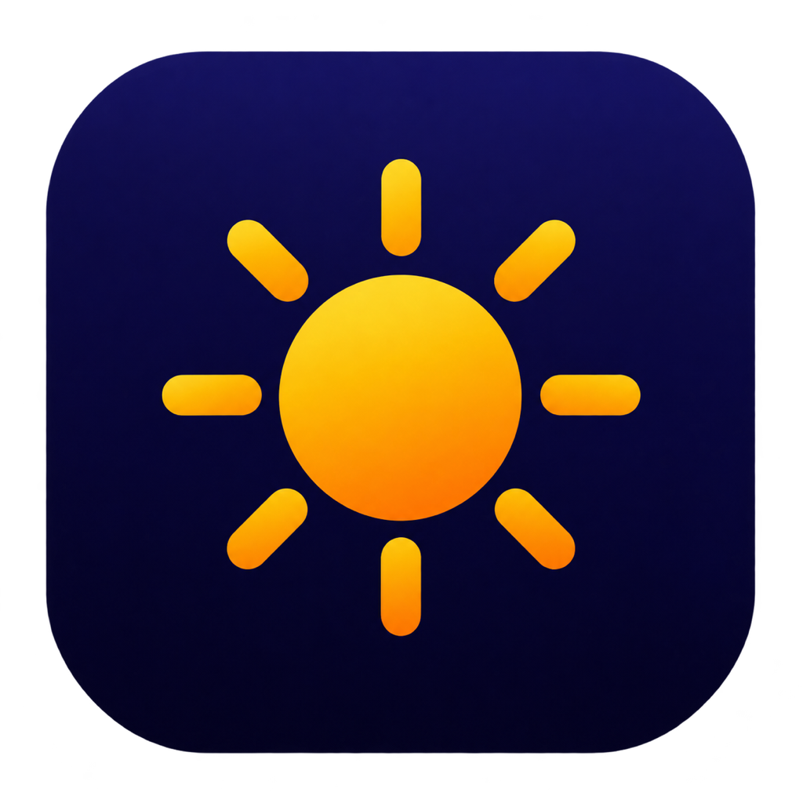

# XDRBoost

Extra brightness for built-in XDR displays, controlled from the macOS menu bar.

Adjust the boost, pause it when you need accurate colors, and quit to restore your display settings. XDRBoost handles sleep, thermal limits, and unexpected exits. Built with Swift and AppKit; no third-party dependencies or network access.

## Install

Requires an Apple Silicon Mac, macOS 13+, an XDR-capable built-in display, and [Command Line Tools](https://developer.apple.com/xcode/resources/).

```sh
git clone https://github.com/7uvss/XDRBoost.git
cd XDRBoost
./build.sh
open XDRBoost.app
```

The build produces an ad hoc signed app. It is not notarized. Tested on a 16-inch MacBook Pro (2021, M1 Pro) running macOS 27.2.1; other configurations are unverified. External displays are not supported.

## Usage

Click the sun icon in the menu bar, enable the boost, and adjust the slider. Start at **1.25×**. Boost is off on launch; disabling it or quitting restores gamma settings still owned by the app. The interface is currently in Simplified Chinese.

- The slider is a target scale, not a measurement of nits or physical brightness. Available headroom depends on system brightness, display preset, and temperature.
- Gamma adjustment affects color reproduction and increases power use. Disable it for color-critical work.
- A tiny corner EDR trigger may be visible in some screenshots or display configurations. There is no full-screen overlay.

## Development

```sh
./build.sh
./XDRBoost.app/Contents/MacOS/XDRBoost --probe
./XDRBoost.app/Contents/MacOS/XDRBoost --self-test
```

Quit the app before `--self-test`; it briefly changes display brightness. CI checks the build and app bundle. Hardware tests require a real XDR display.

[Contributing](CONTRIBUTING.md) · [Changelog](CHANGELOG.md) · [Report a bug](https://github.com/7uvss/XDRBoost/issues)

## License

[GPL-3.0](LICENSE). EDR and gamma techniques are adapted from [BrightXDR](https://github.com/starkdmi/BrightXDR) and [BrightIntosh](https://github.com/niklasr22/BrightIntosh). See [third-party notices](THIRD_PARTY_NOTICES.md).
